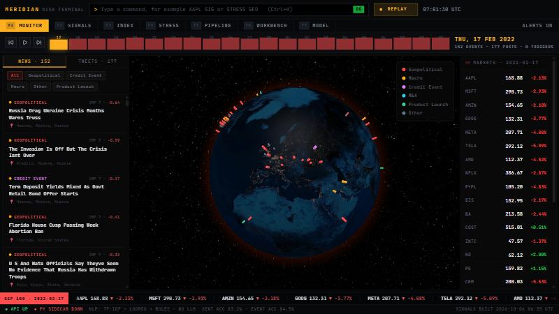
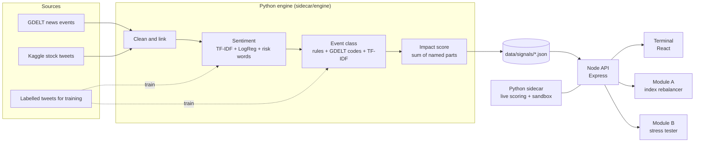

# Meridian

Meridian is a risk terminal for the S&P Global hackathon.
It changes financial news and tweets into risk signals.
It uses the signals to rebalance an index and to stress-test a bank book.
Meridian does not use an LLM. All models are classic NLP models that you can explain.



## What Meridian does

- **Risk engine.** The engine reads GDELT news and Kaggle stock tweets. For each company-day and each news event, it gives three values: a sentiment score (-1.0 to 1.0), an event class and an impact score (1 to 10).
- **Module A: index rebalancer.** A sentiment-tilted index of 16 S&P 100 stocks. Positive sentiment increases a weight. Negative sentiment decreases a weight. Caps, a floor and a turnover limit control the weights.
- **Module B: stress tester.** A demo bank book of loans, bonds, equities and derivatives. A Geopolitical event with impact above 7 triggers a preset shock. The terminal shows the value and the CET1 ratio before and after the shock.
- **Terminal.** A Bloomberg-style interface with a command line, function keys, a 3D risk globe, a replay of the Russia-Ukraine crisis (17 Feb to 9 Mar 2022) and a Python workbench.

## Results

| Check | Result |
|---|---|
| Sentiment model, held-out tweets (2,388 rows) | 83.2% accuracy, macro F1 0.78 |
| Event classifier, held-out tweets (4,117 rows) | 84.5% accuracy, macro F1 0.78 |
| Next-day price move after a high-impact company-day (impact 7 or more) | 3.29% on average |
| Next-day price move after a low-impact company-day (impact 3 or less) | 1.95% on average |
| Geopolitical preset shock on the demo bank book | -$196.1M (-4.3%), CET1 13.9% to 10.4% |

The impact check uses only past data for each baseline. The terminal shows these values in the Model view (F7).

## Architecture



| Part | Folder | Language | Job |
|---|---|---|---|
| Engine | `sidecar/engine` | Python | Downloads data, trains the models, writes the signal files |
| Sidecar | `sidecar` | Python, FastAPI | Live scoring and the Python workbench sandbox. Listens on 127.0.0.1 only |
| API | `backend-node` | TypeScript, Express | Serves the signals. Runs Module A and Module B. Calls the sidecar |
| Terminal | `frontend` | React, Vite | The user interface |

## Data sources

| Source | Use | Link |
|---|---|---|
| GDELT 1.0 daily event files | News events with a location (text source 1) | <http://data.gdeltproject.org/events/index.html> |
| Stock Tweets for Sentiment Analysis and Prediction (Kaggle, Hugging Face mirror) | Dated tweets and daily prices (text source 2) | <https://huggingface.co/datasets/khaihernlow/stock-tweets-for-sentiment-analysis-and-prediction> |
| Twitter Financial News Sentiment | Labels for the sentiment model | <https://huggingface.co/datasets/zeroshot/twitter-financial-news-sentiment> |
| Twitter Financial News Topic | Labels for the event classifier | <https://huggingface.co/datasets/zeroshot/twitter-financial-news-topic> |

The bank book in Module B is synthetic. It does not describe a real bank.

## Requirements

- Python 3.11 or later
- Node.js 20 or later
- About 250 MB of free disk space for the raw data (only if you build the signals again)

## Install and start

The repository includes the signal files. You do not have to run the engine before the demo.

1. Install the Python packages:
   ```bash
   pip install -r sidecar/requirements.txt
   ```
2. Install the API packages:
   ```bash
   npm --prefix backend-node install
   ```
3. Install the web packages:
   ```bash
   npm --prefix frontend install
   ```
4. Train the models. This step also downloads the labelled data (about 5 MB):
   ```bash
   cd sidecar && python -m engine.pipeline
   ```
   The first run also downloads the GDELT files (about 200 MB). Later runs use the cached files.
5. Start the API. The API starts the sidecar:
   ```bash
   npm --prefix backend-node run dev
   ```
6. In a second terminal, start the web app:
   ```bash
   npm --prefix frontend run dev
   ```
7. Open <http://localhost:5173> in a browser.

The API uses port 8787. The sidecar uses port 8090. The web app uses port 5173.
To change a port, copy `backend-node/.env.example` to `backend-node/.env` and change the value.

## Use the terminal

| Key | View | What you see |
|---|---|---|
| F1 | MONITOR | Risk globe, news and tweets of the replay day, market prices |
| F2 | SIGNALS | Heatmap of sentiment and impact for each stock and day |
| F3 | INDEX | Module A: index value, weights over time, statistics |
| F4 | STRESS | Module B: scenarios, P&L waterfall, CET1 ratio, positions |
| F5 | PIPELINE | Engine stages and live scoring of any text |
| F6 | WORKBENCH | Python on the signal data |
| F7 | MODEL | Model accuracy and the impact check |

Press Ctrl+K to type a command. Examples:

| Command | Result |
|---|---|
| `AAPL SIG` | Opens the Signals view for Apple |
| `STRESS GEO` | Runs the Geopolitical preset shock |
| `DAY 2022-02-24` | Moves the replay to 24 February 2022 |
| `PLAY` / `STOP` | Starts or stops the replay |
| `THEME LIGHT` / `THEME DARK` | Changes the theme. Use the light theme on a projector |

The **LIGHT** / **DARK** button in the function key bar also changes the theme. The terminal keeps your choice for the next visit.

During the replay, a day with a severe event (impact 9 or more) shows a red alert.
Click **RUN STRESS TEST** to apply the shock that the event triggers.

## API

All routes start with `/api`.

| Method | Route | Result |
|---|---|---|
| GET | `/health` | Status of the API and the sidecar |
| GET | `/signals/companies?ticker=&from=&to=` | Company-day signals |
| GET | `/signals/events?date=&minImpact=&eventClass=` | News event signals |
| GET | `/signals/posts?date=&ticker=` | Scored tweets in the replay window |
| GET | `/signals/export.csv` | All signals with the three required fields |
| GET | `/prices`, `/universe` | Daily prices and the stock list |
| GET | `/pipeline`, `/model` | Stage metrics and model metrics |
| GET | `/replay/timeline` | One summary for each replay day |
| GET | `/index?tilt=&cap=&maxTurnover=&rebalance=` | Module A result |
| GET | `/stress/scenarios`, `/stress/portfolio` | Presets and the bank book |
| POST | `/stress/run` | Module B result. Body: `{ "scenarioId" }`, `{ "eventId" }` or `{ "shocks" }` |
| POST | `/score` | Live score of one text. Body: `{ "text" }` |
| POST | `/workbench/run` | Runs Python in the sandbox. Body: `{ "code" }` |

## Engine method

**Sentiment.** A TF-IDF model with logistic regression gives P(bullish) and P(bearish). The score is P(bullish) minus P(bearish). For news text, a fixed finance-risk word list adjusts the score (60% model, 40% word list). News scores also use the GDELT tone (30%). Each score lists the words that changed it most.

**Event class.** Keyword rules apply first. Then the GDELT conflict codes apply. Then a TF-IDF classifier gives the class. The classifier learns from 20 tweet topics that map to six classes: Geopolitical, Macro, Credit Event, M&A, Product Launch and Other.

**Impact.** The impact score is a sum of named parts, rounded to 1 to 10.
- News: tone, event class, number of mentions, conflict severity, market relevance, stock coverage.
- Company-day: abnormal attention (posts against the median of the 30 days before), tone, event class.

## Security

- The sidecar listens on 127.0.0.1 only. The browser cannot call it.
- The API accepts browser requests only from the origins in `CORS_ORIGINS`.
- A rate limit applies to each client IP.
- The API checks all input with zod schemas and limits the size of text and code.
- Error responses do not show internal details.
- The workbench sandbox allows a fixed list of imports and stops code after 30 seconds. It is an in-process sandbox. For a production system, run each job in a separate container without network access.

## Limits

- The text sources are historical. The replay shows 17 February to 9 March 2022.
- News headlines come from the words in the article URL. GDELT does not supply the headline text.
- The sentiment-tilted index did not beat equal weight over the full year (-0.98% active return). The tilt is a risk view, not a trading signal.
- The bank book and the shock sizes are examples.

## Project layout

```
backend-node/   Express API (controllers, services, routes, middleware, tests)
frontend/       React terminal (terminal shell, panels)
sidecar/        FastAPI sidecar and the engine (sidecar/engine)
data/signals/   Signal files that the engine writes
docs/           Demo script and screenshots
```
