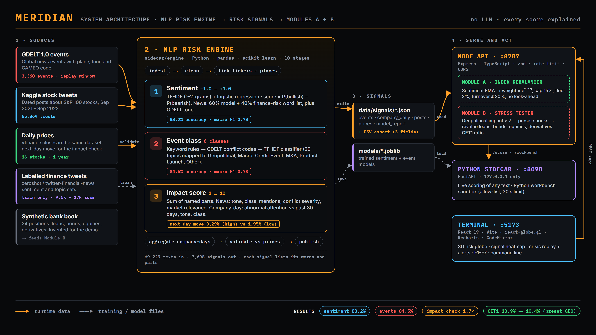
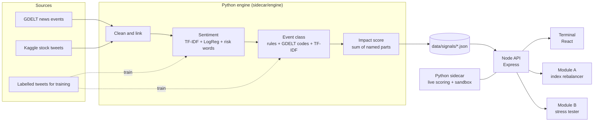

# Meridian - S&P Global & Crisil Campus Hackathon

**Candidate Name:** Krrish Rastogi
**College Email ID:** btech10312.23@bitmesra.ac.in
**College / Campus:** Birla Institute of Technology, Mesra (Ranchi)
**Demo Video Link:** https://youtu.be/-Iv1oitC3ZM
**Slide Deck:** [docs/presentation.pdf](docs/presentation.pdf)


## 1. Project Overview / Problem Statement & Approach

A sanction, a default or a war changes market and credit risk on the day of the news, before the change shows in prices or ratings. The news arrives as unstructured text: thousands of articles and posts each day. A risk team needs that text as structured signals, and it needs to know why each signal has its value. A score that nobody can explain does not pass model-risk review.

Meridian is a risk terminal that changes financial news (GDELT) and stock tweets (Kaggle) into risk signals. For each company-day and each news event, the **NLP Risk Engine** gives three fields: a **sentiment score** (-1.0 to 1.0), an **event class** (Geopolitical, Macro, Credit Event, M&A, Product Launch, Other) and an **impact score** (1 to 10). Meridian does not use an LLM. All models are classic NLP models, and every value lists the words, rules and parts that made it.

Meridian implements both downstream modules of the brief:

- **Module A: index rebalancer.** A sentiment-tilted index of 16 S&P 100 stocks. Positive sentiment increases a weight. Negative sentiment decreases a weight. Caps, a floor and a turnover limit control the weights.
- **Module B: stress tester.** A synthetic bank book of loans, bonds, equities and derivatives. A Geopolitical event with impact above 7 triggers a preset shock. The terminal shows the value and the CET1 ratio before and after the shock.
- **Terminal.** A Bloomberg-style interface with a command line, function keys, a 3D risk globe, a replay of the Russia-Ukraine crisis (17 Feb to 9 Mar 2022) and a Python workbench.

## 2. Architecture & Tech Stack





| Part | Folder | Stack | Job |
|---|---|---|---|
| Engine | `sidecar/engine` | Python, pandas, scikit-learn | Downloads data, trains the models, writes the signal files (10 logged stages) |
| Sidecar | `sidecar` | Python, FastAPI, uvicorn | Live scoring and the Python workbench sandbox. Listens on 127.0.0.1 only |
| API | `backend-node` | Node.js, TypeScript, Express, zod, pino | Serves the signals. Runs Module A and Module B. Calls the sidecar |
| Terminal | `frontend` | React 19, Vite, Tailwind CSS, react-globe.gl, Recharts, CodeMirror | The user interface |

**Why classic NLP and no LLM.** The models score 68,000 texts in about 7 seconds on a laptop CPU, give the same output on every run, cost nothing per call and show the reason for every value. Each signal is easy to audit and to validate, which matters for a risk use case.

## 3. Dataset Used

| Source | Use | Link |
|---|---|---|
| GDELT 1.0 daily event files | News events with a location, tone and CAMEO code (text source 1) | <http://data.gdeltproject.org/events/index.html> |
| Stock Tweets for Sentiment Analysis and Prediction (Kaggle, Hugging Face mirror) | Dated tweets and daily yfinance prices (text source 2) | <https://huggingface.co/datasets/khaihernlow/stock-tweets-for-sentiment-analysis-and-prediction> |
| Twitter Financial News Sentiment | Labels for the sentiment model | <https://huggingface.co/datasets/zeroshot/twitter-financial-news-sentiment> |
| Twitter Financial News Topic | Labels for the event classifier | <https://huggingface.co/datasets/zeroshot/twitter-financial-news-topic> |
| Natural Earth 1:110m countries (public domain) | Country outlines on the globe (frontend/public/countries.geojson) | <https://www.naturalearthdata.com/> |

All sources are public. The [`data/`](data/README.md) folder holds all data used: the signal files that the prototype runs on (`data/signals/`), the labelled training sets and daily prices (`data/raw/`), and the synthetic bank book and stress scenarios (`data/synthetic/`). The two large raw files (stock tweets, about 24 MB, and GDELT, about 160 MB) are downloaded by the engine on its first run; [data/README.md](data/README.md) lists every file and its source.

Assumptions:

- The bank book in Module B is synthetic (24 positions, exported to `data/synthetic/bank_book.json`). It does not describe a real bank. The shock sizes are examples.
- GDELT does not supply headline text. Headlines come from the words in the article URL.
- The text sources are historical. The replay shows 17 February to 9 March 2022.

## 4. Quickstart & Installation

Runtime: Python 3.11 or later (tested with 3.13) and Node.js 20 or later (tested with 24) on Windows 11.

```bash
git clone https://github.com/krrishrastogi05/bitmesra-krrish-rastogi-hackathon.git
cd bitmesra-krrish-rastogi-hackathon
pip install -r requirements.txt
npm --prefix backend-node install
npm --prefix frontend install

# Train the models and build the signals. The first run downloads about 200 MB and takes a few minutes.
cd sidecar && python -m engine.pipeline && cd ..

# Start the API. The API starts the Python sidecar.
npm --prefix backend-node run dev

# In a second terminal, start the web app, then open http://localhost:5173
npm --prefix frontend run dev
```

The repository includes the signal files, so all views except live scoring and the workbench work without an engine run. Live scoring and the workbench need the trained models in `sidecar/models/`, which the engine run creates. Later engine runs use the cached downloads.

The API uses port 8787, the sidecar port 8090 and the web app port 5173. To change a port, copy `backend-node/.env.example` to `backend-node/.env` and change the value.

## 5. Key Results & Domain Impact

| Check | Result | Naive baseline |
|---|---|---|
| Sentiment model, held-out tweets (2,388 rows) | 83.2% accuracy, macro F1 0.78 | 65.6% (always "neutral") |
| Event classifier, held-out tweets (4,117 rows) | 84.5% accuracy, macro F1 0.78 | 45.3% (always "Other") |
| Next-day price move after a high-impact company-day (impact 7 or more) | 3.29% on average | 1.95% after a low-impact day (impact 3 or less) |
| Geopolitical preset shock on the demo bank book | -$196.1M (-4.3%), CET1 13.9% to 10.4% | |
| Severe geopolitical shock (impact 9 alert) | -$274.5M (-6.0%), CET1 13.9% to 9.0% | |

The impact check uses only past data for each baseline. The terminal shows these values in the Model view (F7).

Domain impact:

- **Early warning.** In the replay, Meridian raised its first Geopolitical alert on 18 February 2022 and its first severe alert (impact 9) on 21 February, three days before the invasion on 24 February.
- **From headline to capital.** An alert opens a stress test on the day of the event: value before and after, P&L by risk factor and the CET1 ratio.
- **Auditable.** Every sentiment, class and impact value shows its reasons, which suits model-risk governance.
- **Cheap to run.** No GPU and no LLM API cost. The whole pipeline runs on a laptop.

## Use the terminal

| Key | View | What you see |
|---|---|---|
| F1 | MONITOR | Risk globe, news and tweets of the replay day, market prices |
| F2 | SIGNALS | Heatmap of sentiment and impact for each stock and day |
| F3 | INDEX | Module A: index value, weights over time, statistics |
| F4 | STRESS | Module B: scenarios, P&L waterfall, CET1 ratio, positions |
| F5 | PIPELINE | Engine stages and live scoring of any text |
| F6 | WORKBENCH | Python on the signal data |
| F7 | MODEL | Model accuracy and the impact check |

Press Ctrl+K to type a command. Examples:

| Command | Result |
|---|---|
| `AAPL SIG` | Opens the Signals view for Apple |
| `STRESS GEO` | Runs the Geopolitical preset shock |
| `DAY 2022-02-24` | Moves the replay to 24 February 2022 |
| `PLAY` / `STOP` | Starts or stops the replay |
| `THEME LIGHT` / `THEME DARK` | Changes the theme. Use the light theme on a projector |

The **LIGHT** / **DARK** button in the function key bar also changes the theme. The terminal keeps your choice for the next visit.

During the replay, a day with a severe event (impact 9 or more) shows a red alert.
Click **RUN STRESS TEST** to apply the shock that the event triggers.

## API

All routes start with `/api`.

| Method | Route | Result |
|---|---|---|
| GET | `/health` | Status of the API and the sidecar |
| GET | `/signals/companies?ticker=&from=&to=` | Company-day signals |
| GET | `/signals/events?date=&minImpact=&eventClass=` | News event signals |
| GET | `/signals/posts?date=&ticker=` | Scored tweets in the replay window |
| GET | `/signals/export.csv` | All signals with the three required fields |
| GET | `/prices`, `/universe` | Daily prices and the stock list |
| GET | `/pipeline`, `/model` | Stage metrics and model metrics |
| GET | `/replay/timeline` | One summary for each replay day |
| GET | `/index?tilt=&cap=&maxTurnover=&rebalance=` | Module A result |
| GET | `/stress/scenarios`, `/stress/portfolio` | Presets and the bank book |
| POST | `/stress/run` | Module B result. Body: `{ "scenarioId" }`, `{ "eventId" }` or `{ "shocks" }` |
| POST | `/score` | Live score of one text. Body: `{ "text" }` |
| POST | `/workbench/run` | Runs Python in the sandbox. Body: `{ "code" }` |

## Engine method

**Sentiment.** A TF-IDF model with logistic regression gives P(bullish) and P(bearish). The score is P(bullish) minus P(bearish). For news text, a fixed finance-risk word list adjusts the score (60% model, 40% word list). News scores also use the GDELT tone (30%). Each score lists the words that changed it most.

**Event class.** Keyword rules apply first. Then the GDELT conflict codes apply. Then a TF-IDF classifier gives the class. The classifier learns from 20 tweet topics that map to six classes: Geopolitical, Macro, Credit Event, M&A, Product Launch and Other.

**Impact.** The impact score is a sum of named parts, rounded to 1 to 10.
- News: tone, event class, number of mentions, conflict severity, market relevance, stock coverage.
- Company-day: abnormal attention (posts against the median of the 30 days before), tone, event class.

## Security

- The sidecar listens on 127.0.0.1 only. The browser cannot call it.
- The API accepts browser requests only from the origins in `CORS_ORIGINS`.
- A rate limit applies to each client IP.
- The API checks all input with zod schemas and limits the size of text and code.
- Error responses do not show internal details.
- The workbench sandbox allows a fixed list of imports and stops code after 30 seconds. It is an in-process sandbox. For a production system, run each job in a separate container without network access.

## Limits

- The text sources are historical. The replay shows 17 February to 9 March 2022.
- News headlines come from the words in the article URL. GDELT does not supply the headline text.
- The sentiment-tilted index did not beat equal weight over the full year (-0.98% active return). The tilt is a risk view, not a trading signal.
- The bank book and the shock sizes are examples.

## Project layout

```
backend-node/   Express API (controllers, services, routes, middleware, tests)
frontend/       React terminal (terminal shell, panels)
sidecar/        FastAPI sidecar and the engine (sidecar/engine)
data/           All data used: signals/ (engine output), raw/ (training sets, prices), synthetic/ (bank book, scenarios)
docs/           Presentation (presentation.pdf), architecture diagram, demo script and screenshots
```

## License

MIT. See [LICENSE](LICENSE).
